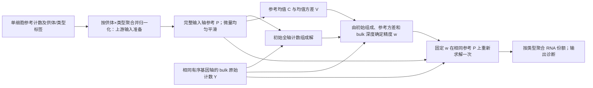

# 方法图与冻结代码逐框对应

方法 ID：`FULL_DONOR_PRECISION`；包版本：`0.1.0`。
以 `src/cellmem_full_axis/api.py` 为工作流拥有者。原核心保留的历史双臂函数
用于一致性测试，不表示默认路径同时运行面板分支。

| 框 | 原子操作 | 源码位置 |
|---|---|---|
| 输入合同 | `F`/计数同形，非负有限，参考列和为1，类型ID连续，所有输出类型有参考 | `api.py` 20–62 行；`io.py` |
| 平滑 | `d=median(reference_count_sums.sum(0))`，`epsilon=1/(d+1)`，`P=(1-epsilon)F+epsilon/G` | `_frozen_core.py` 10–21 行 |
| 初始解 | `q=Y/N`，最小化 `sum(Px-q*log(Px))`，`x>=0,sum(x)=1` | `api.py` 67、77–79 行 |
| 参考统计 | 每类参考列均值 `C`；有至少2供体时 `V=sample_variance(P)/D` | `api.py` 68–73 行 |
| 精度 | `mu=C*pi0`，`v=V*(pi0**2)`，`w=mu/(mu+N*v)` | `api.py` 79–82 行 |
| 再求解 | 固定 `w`，最小化 `sum(w*(Px-q*log(Px)))`，相同单纯形约束 | `api.py` 83 行；`_frozen_core.py` 23–76 行 |
| 输出 | 参考列系数按类型加和；保存初始/最终系数、精度、支持量与认证信息 | `api.py` 84–112 行 |

绘图必须保留的含义：

1. 参考供体×类型聚合是上游数据准备，公开 `predict()` 从已构建的矩阵开始。
2. `mu=C*pi0` 一般不等于第一次拟合的 `P*x0`；不要在图里把两者画成同一个张量。
3. 外层精度只计算一次。求解器内部 SLSQP、Newton、坐标精修属于数值求解，不是反复训练。
4. 线性项 `sum(w*Px)` 必须保留，目标表达为0的基因仍约束拟合表达量。
5. `V` 为参考均值方差，不是完整新供体预测方差。单供体类型不借方差。
6. 输出是当前输入全基因轴上的 RNA 份额，类型选择/阈值评分属于另行定义的评价层。
7. 不画固定828面板、Jevos、VarPool借用、自动注释或UNKNOWN；这些不是当前执行路径。
